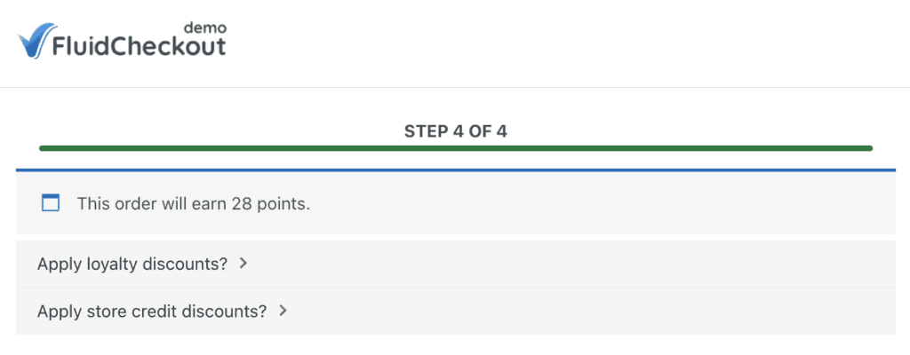

# Advanced Coupons for WooCommerce by Rymera Web Co

Fluid Checkout adjusts the default placement of Advanced Coupons for WooCommerce loyalty elements to provide a more consistent and user-friendly interface. Normally the plugin displays loyalty discounts and store credits after the order totals on the checkout page.

Within Fluid Checkout this position does not integrate well with the step-based layout. For that reason we moved the elements to appear earlier in the process. The loyalty information is now displayed in the `before_checkout_steps` hook right after the Advanced Coupons order notice showing the number of points earned.

This change ensures a balanced layout avoids visual clutter in the totals section and creates a smoother checkout experience for customers using loyalty features.

