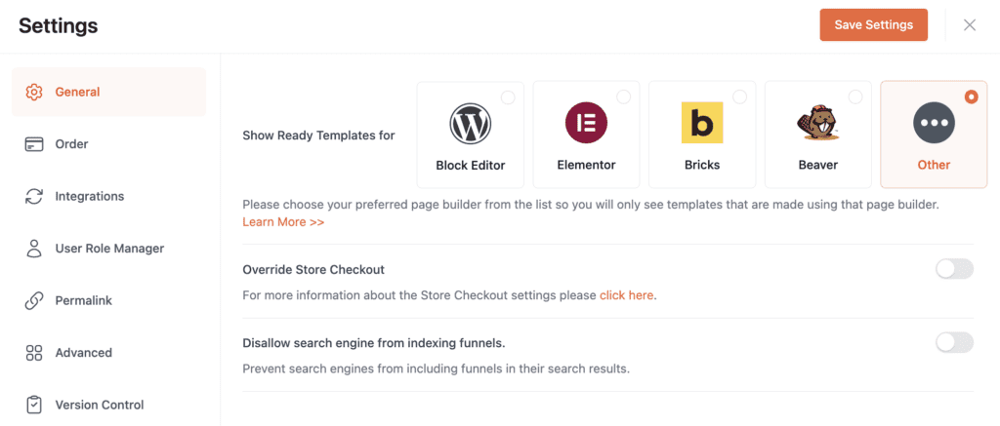
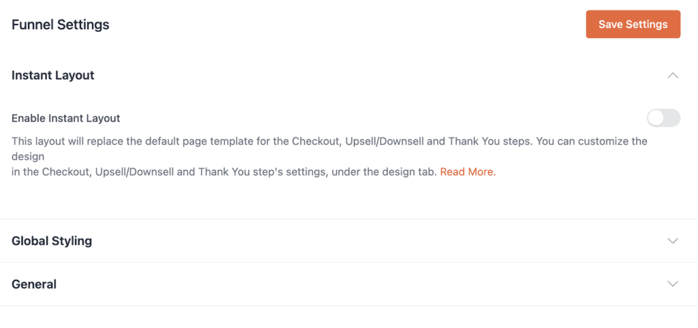
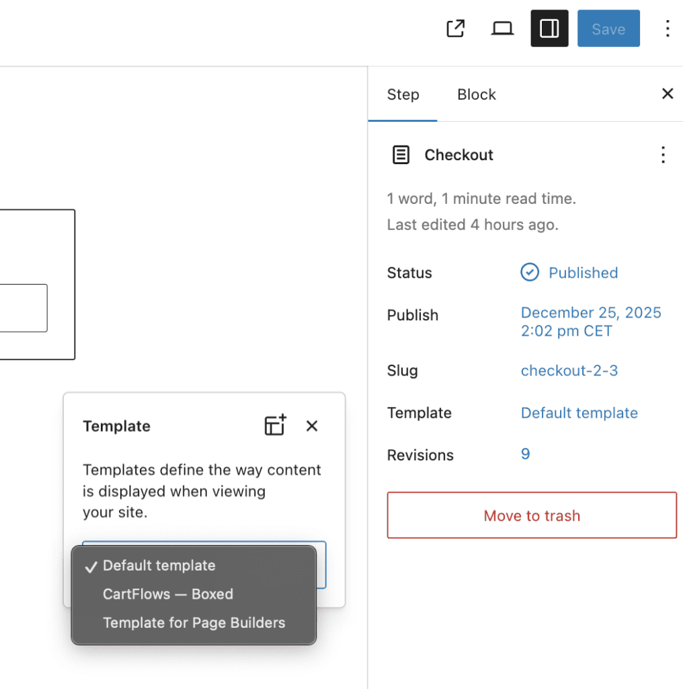
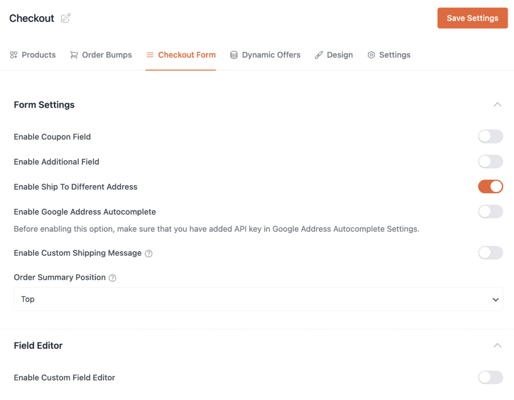
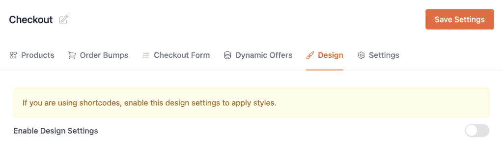

# Compatibility with plugin CartFlows

## CartFlows and Fluid Checkout Compatibility Guide {/* #subscribe-box */}

This document explains how to correctly configure CartFlows when using Fluid Checkout to avoid conflicts and ensure a stable checkout experience.

## Incompatible CartFlows Settings

The following CartFlows features are **not compatible** with Fluid Checkout and must be set as follow.

### Global Settings

CartFlows **Ready Templates** are not compatible with Fluid Checkout.

These templates apply their own checkout layout structure scripts and field handling. Fluid Checkout also replaces and controls the checkout layout and logic. When both are active they attempt to modify the same checkout elements which leads to broken layouts, missing fields and errors.

- The only supported CartFlows ready templates is **Other**.
- When using **Other** you must add the `woocommerce_checkout` shortcode to the funnel pages for Checkout and Thank you pages.

This ensures Fluid Checkout can correctly render and manage the checkout flow without interference.

### Funnel Settings

- Disable “Enable Instant Layout” Setting.

### Checkout Page Settings

Add the products related to the checkout funnel as usual. After that, proceed with the configurations below.

#### Page templates

CartFlows adds several page templates. The default option, “Template for Page Builders”, is not supported. Because of this, the page template must be set to “Default template.”

#### Checkout Form Tab

On the Form settings please choose the following setting.

- Enable “Enable Ship To Different Address”.
- Disable all the remaining fields as they may conflict with Fluid Checkout settings.

On the Field Editor please choose the following setting.

- Disable “Enable Custom Field Editor”

#### Design Tab

- Disable “Enable Design Settings”

These options override checkout structure and fields which directly conflicts with Fluid Checkout behavior.
