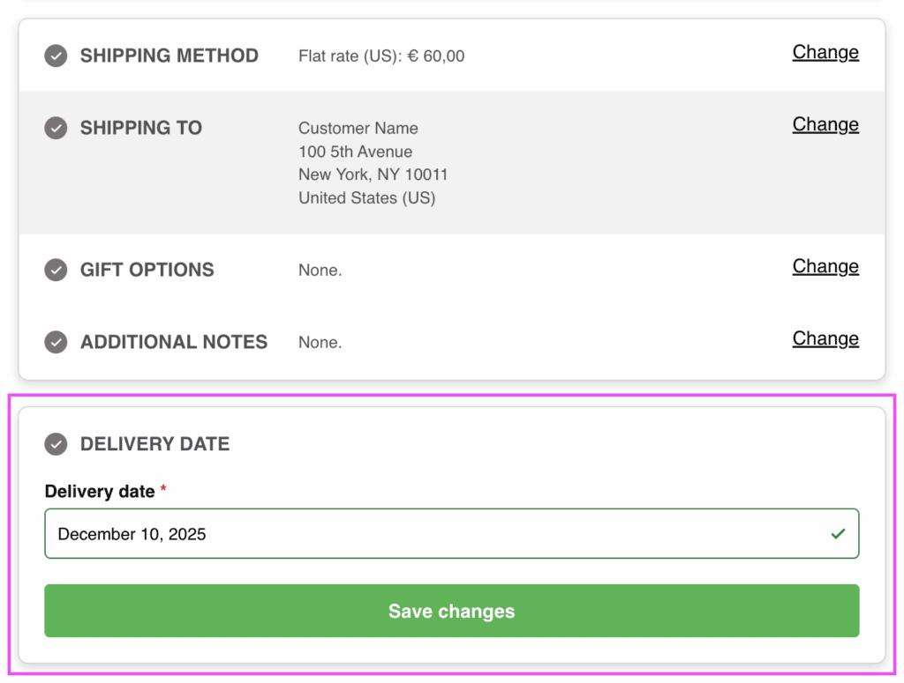
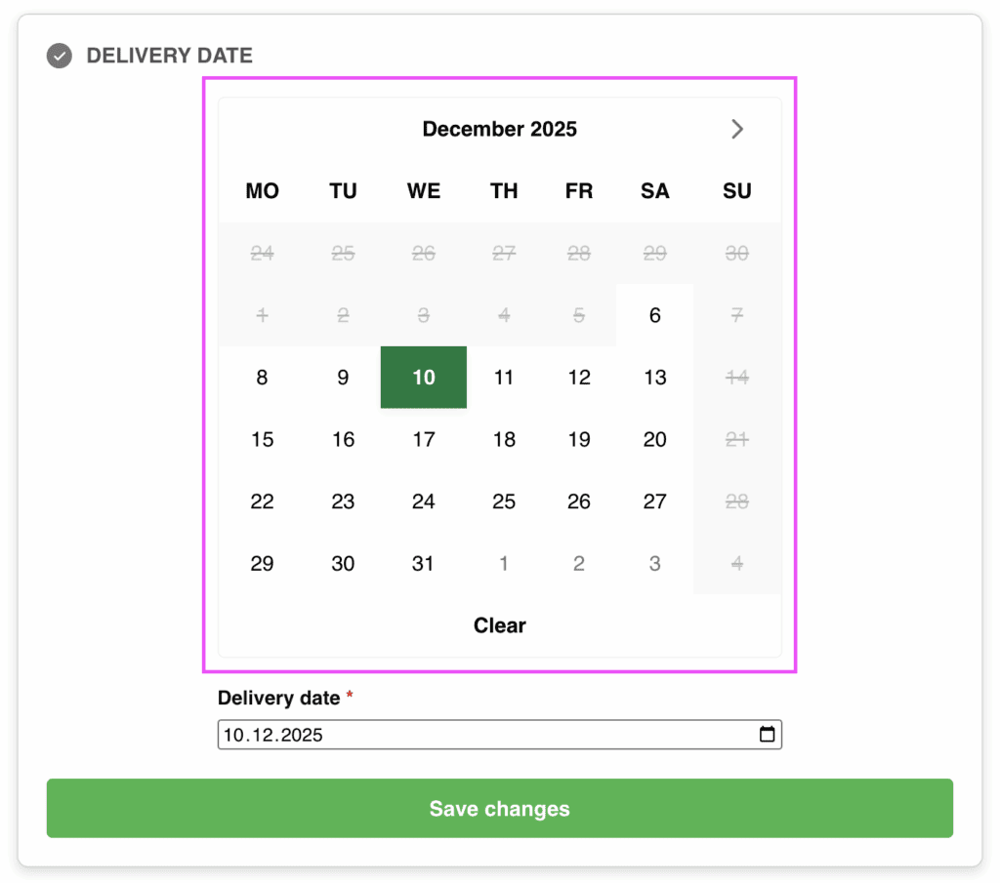

# Compatibility with Delivery Date or Pickup Date plugins

Fluid Checkout works with several popular plugins that add order delivery date or pickup date, and associated fields to the WooCommerce Checkout form. The integration with these plugins is only available with [Fluid Checkout PRO](https://fluidcheckout.com/).

## Compatible plugins

Currently, [Fluid Checkout PRO](https://fluidcheckout.com/) is compatible with the following delivery date or pickup date plugins:

- [Order Delivery for WooCommerce by Kestrel](https://woocommerce.com/products/woocommerce-order-delivery/)
- [Iconic Delivery Slots for WooCommerce](https://woocommerce.com/products/iconic-delivery-slots-for-woocommerce/)
- [Order Delivery Date Pro for WooCommerce by Tyche Softwares](https://www.tychesoftwares.com/products/woocommerce-order-delivery-date-pro-plugin/)
- [Delivery & Pickup Date Time for WooCommerce By CodeRockz (free version)](https://wordpress.org/plugins/woo-delivery/)
- [Delivery & Pickup Date Time for WooCommerce By CodeRockz (paid PRO version)](https://coderockz.com/downloads/woocommerce-delivery-date-time-wordpress-plugin/)

## Delivery or pickup date field in a separate sub-step section

The delivery date and pickup date fields will appear as a separate sub-step, and sometimes as a completely separate step, that will be displayed on the optimal position within the checkout form according to the selected option from that plugin settings.

## Extra integration options

In some cases, new options might be added in the plugin integrations settings at WP Admin > Fluid Checkout > Settings > Integrations. The options in this settings page will only appear when the related plugins are activated.

One example of such extra options the inline calendar view option for the integration with the plugin [Order Delivery for WooCommerce by Kestrel](https://woocommerce.com/products/woocommerce-order-delivery/). When this option is selected, the delivery date will be displayed as an inline, already expanded calendar view showing the available dates:

For more information on how to enable the this calendar view, see the documentation page for the [compatibility with the Order Delivery for WooCommerce by Kestrel](/compatibility/plugins/order-delivery/).
