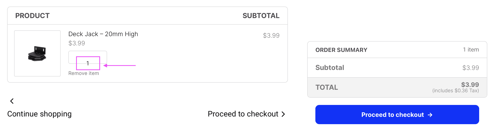

# Compatibility with plugin Elementor

## Broken order received (thank you) page layout

This is a know issue with Elementor. What happens is that Elementor PRO redirects the customer to a custom thank you page if it was configured previously as the “Purchase Summary” page in the Elementor settings, but it will not automatically restore the original WooCommerce thank you page.

### Enable the optimized thank you page from Fluid Checkout PRO

Follow the steps below if you wish to stop using the Elementor’s custom thank you page and restore the original thank you page from WooCommerce or use Fluid Checkout’s optimized thank you page.

1. Open any page to *edit with Elementor;*
2. Go to Elementor Menu > Site Settings > WooCommerce;
3. Remove the page selected for the dropdown field “Purchase Summary”;
4. Save the changes.
5. Go to WP Admin > Fluid Checkout > Settings > Thank you.
6. Check the option “*Enable thank you page and order details optimizations*“.
7. Save the settings changes.

Please note that Elementor redirects the customers to a different page when the “Purchase Summary” option has a selected page in the Elementor settings, so refreshing the thank you page might not work as expected. Although, whenever a new order is completed the native WooCommerce thank you page or Fluid Checkout’s optimized thank you page will be displayed.

### Keep using the customized thank you page from Elementor PRO

Since Fluid Checkout Lite version 3.1.9, manual content changes are no longer needed to fix the layout issues on the custom order received page created with Elementor PRO.

Otherwise, to keep using the Elementor’s customized thank you page and fix this issue you will need to make sure you have the “Purchase Summary” widget provided by Elementor PRO added to that page.

Follow the steps below to fix the thank you page content and keep using the custom thank you page from Elementor:

1. Open the custom thank you page to *edit with Elementor;*
2. Go to Elementor Menu > Site Settings > WooCommerce;
3. Make sure the page is selected for the dropdown field “Purchase Summary”;
4. Save the changes.
5. Go back to edit the custom thank you page contents with the Elementor editor.
6. Search for “Purchase Summary” in the widgets/elements section.
7. Drag and drop the widget “Purchase Summary” into the desired place on the custom thank you page.
8. Save the changes.
9. Go to WP Admin > Fluid Checkout > Settings > Thank you.
10. Make sure the option “*Enable thank you page and order details optimizations*” is unchecked/disabled.
11. Save the settings changes.

## Layout issues with checkout an cart pages created with Elementor

Depending on how the cart and checkout forms were added to the page, Elementor thinks it needs to automatically convert spaces in the code into line breaks and paragraphs, leading to some layout issues.

### Progress bar seemingly frozen at the first step on the checkout page

Sometimes when using Elementor, the progress bar might be displayed “frozen” at the first step and not “growing” as the customer proceeds through the checkout steps, and there might be too much space between some elements on the checkout page.

### Brief layout glitch on the product quantity fields fields on the cart page

When first loading the cart page, the quantity fields or just the quantity number is briefly shown out of place, then after a couple of seconds it usually gets back to its normal and expected place.

### Solution

The solution for this issue is to **ensure the checkout form has been added correctly** to the page:

1. Open the **checkout page** to edit in Elementor;
2. Select the “Text Editor” widget which is showing the checkout form;
3. Remove that “Text Editor” widget;
4. Save/Publish your changes;
5. Visit your your checkout page and check that checkout form is **not displayed**; this is the expected behavior at this point;
6. Go back to edit the checkout page in Elementor;
7. Add a new “Shortcode” widget from Elementor;
8. Enter the shortcode `[ woocommerce_checkout ]` (without extra spaces around the brackets) in the new “Shortcode” widget;
9. Save/Publish your changes;
10. Visit your checkout page again and check that this time the checkout form **is displayed as expected**.
11. Repeat this process for the **cart page** using the shortcode `[ woocommerce_cart ]` (without extra spaces around the brackets) instead;
