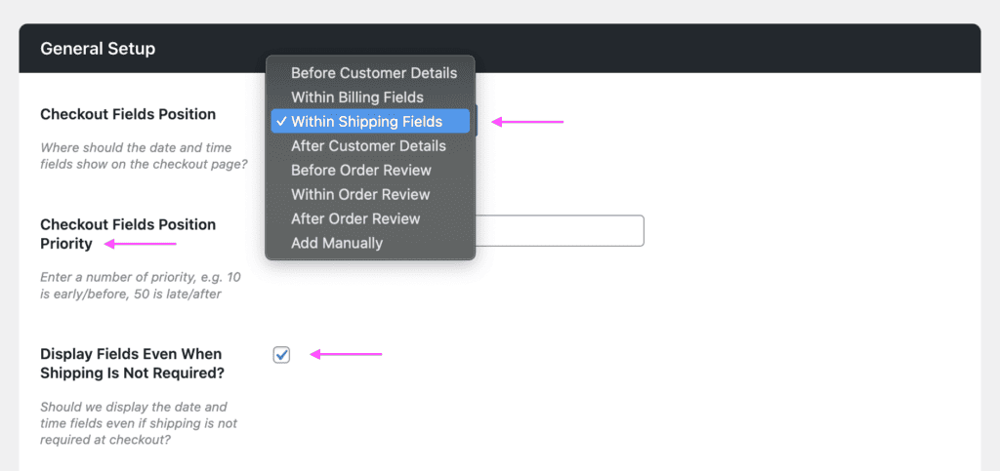

# Compatibility with plugin WooCommerce Delivery Slots by Iconic

## Delivery slots fields position and priority

In the plugin settings page for *WooCommerce Delivery Slots by Iconic* you can find options to set the position where to display the delivery slots fields and fine tune the exact position with by tweaking the priority option.

When using Fluid Checkout, for some of the position options the fields will be displayed as a new sub-step section on the checkout form according to the position defined. For instance, when choosing the position “Within Shipping Field”, a new sub-step section will be added to the checkout form in the Shipping step.

For the following positions the delivery slots fields section is **displayed as sub-steps**:

- Before Customer Details
- Within Billing Fields
- Within Shipping Fields
- Before Customer Details

For the following positions, the delivery slots fields section is **displayed as it would usually be** when not using Fluid Checkout:

- Before Order Review
- Within Order Review
- After Order Review
- Add Manually

## Displaying delivery slot fields when cart contains only virtual products

In case you have the option “Display Fields Even When Shipping Is Not Required” checked and the position set to “Within Shipping Fields” in the *WooCommerce Delivery Slots* plugin settings, the delivery slots fields section will be automatically changed to “Within Billing Fields” as the shipping step is not displayed in this case.

## Filter and action hooks

### Best practices

If you are unsure about how to add the code snippets to your website, check our article:  
[How to safely add code snippets to your WooCommerce website](https://fluidcheckout.com/docs/how-to-add-code-snippets/)

### Actions {/* #1-toc-title */}

- [`fc_pro_woo_delivery_slots_after_fields`](/pro/hooks/fc_pro_woo_delivery_slots_after_fields/) This action hook fires after the delivery slots fields are rendered in the checkout process.

### Filters

- [`fc_pro_is_substep_delivery_slots_visible`](/pro/hooks/fc_pro_is_substep_delivery_slots_visible/) – Filters whether the delivery slots substep is visible.
