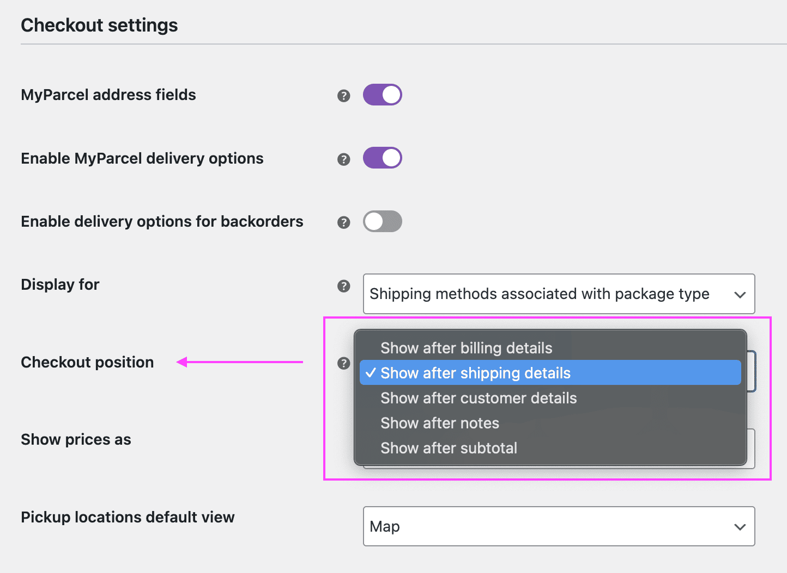

# Compatibility with plugin MyParcel

## Delivery options fields on the checkout page {/* #fields-position */}

In the plugin settings page for *WooCommerce MyParcel* you can find options to set the position where to display its custom fields on the checkout page.

When using Fluid Checkout, changing the position using this option does not work since the positions available do not make sense in the context of the Fluid Checkout’s optimized checkout form and **these fields will always be displayed below the shipping methods** options in the shipping methods section regardless of the position select in the MyParcel plugin settings.
