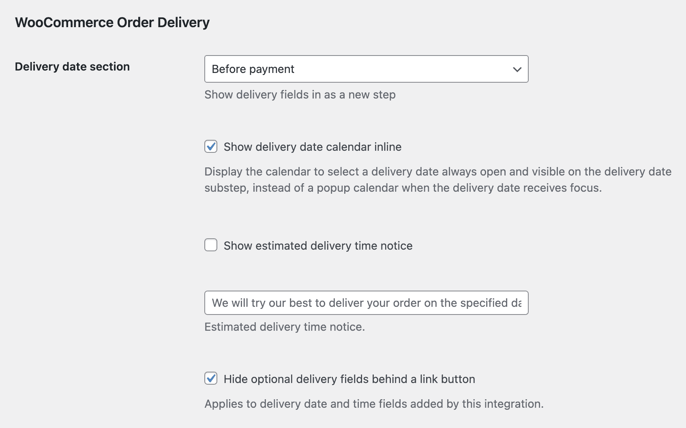

# Compatibility with plugin Order Delivery for WooCommerce by Kestrel

## Delivery date field in a separate step section

The delivery date from the plugin Order Delivery for WooCommerce by Kestrel will appear as separate step, that will be displayed on the optimal position within the checkout form according to the selected option from that plugin settings.

## Extra integration options

Some extra options are available in the integration settings at WP Admin > Fluid Checkout > Settings > Integrations.

Please note these options will only appear when the plugin is activated.

## Inline calendar view

When this option is selected, the delivery date will be displayed as an inline, already expanded calendar view showing the available dates:

### How to enable the inline calendar view

- Go to WP Admin > Fluid Checkout > Settings > Integrations;
- Locate the section “WooCommerce Order Delivery”, which is related to the extra settings for this plugin;
- Check the option “Show delivery date calendar inline”;
- Save your changes.

## Filter and action hooks

### Best practices

If you are unsure about how to add the code snippets to your website, check our article:  
[How to safely add code snippets to your WooCommerce website](https://fluidcheckout.com/docs/how-to-add-code-snippets/)

### Actions

- [`fc_pro_woocommerce_order_delivery_before_fields`](/pro/hooks/fc_pro_woocommerce_order_delivery_before_fields/) This action hook fires before the delivery date fields are rendered in the checkout process.
- [`fc_pro_woocommerce_order_delivery_after_fields`](/pro/hooks/fc_pro_woocommerce_order_delivery_after_fields/) This action hook fires after the delivery date fields are rendered in the checkout process.

### Filters

- `fc_pro_woocommerce_order_delivery_substep_title` – Filters the sub-step title for order delivery substep.
- `fc_pro_woocommerce_order_delivery_position_args` – Filters the position arguments for the order delivery sub-step.
- `fc_pro_woocommerce_order_delivery_priority` – Filters the priority for the order delivery integration.
