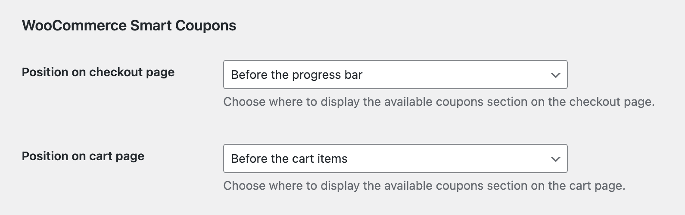

# Compatibility with plugin WooCommerce Smart Coupons by StoreApps

## Position for the available coupons section {/* #subscribe-box */}

By default, WooCommerce Smart Coupons will display the available coupons section at the top of the cart and checkout pages. It is possible to move that section to a few positions by changing the position in the Fluid Checkout integration settings:

1. Go to WP Admin > Fluid Checkout > Settings > Integrations.
2. Locate the section “WooCommerce Smart Coupons”. Keep in mind that it will only be displayed if that plugin is currently active.
3. Choose the position you want the available coupons section to be displayed for the checkout and cart pages separately.
4. Save your changes.
