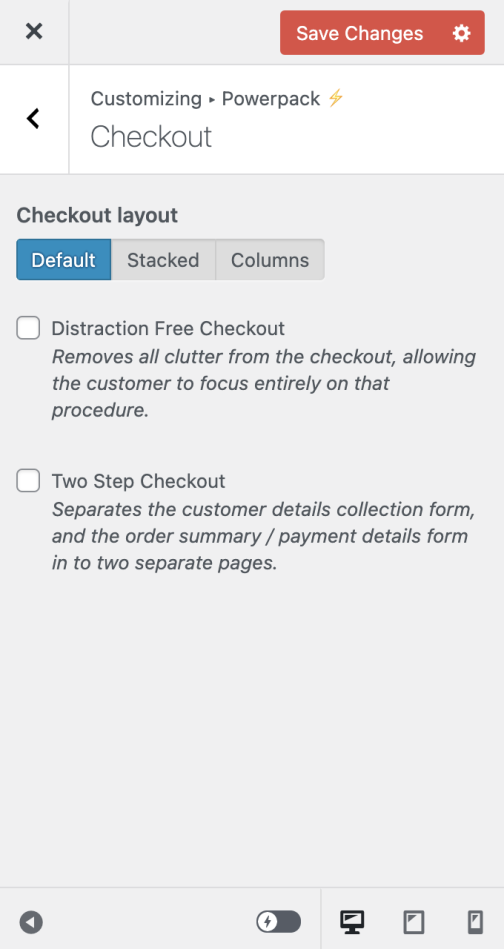

# Compatibility with plugin Storefront Powerpack

## Storefront Powerpack checkout options {/* #checkout-options */}

The plugin Storefront Powerpack has some options to change the layout and behavior of the checkout page which conflicting with features from Fluid Checkout.

When using Fluid Checkout, all these options from the Storefront Powerpack for the checkout page are disabled and cannot be enabled again.

