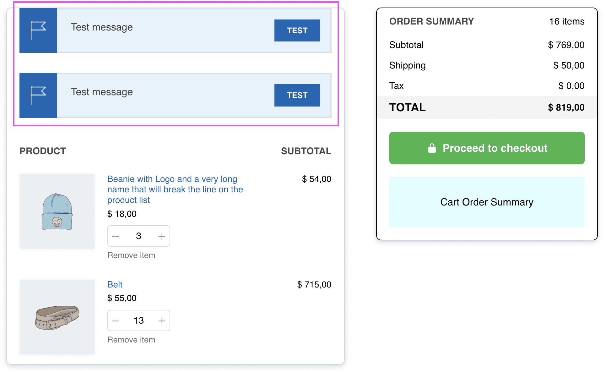

# Compatibility with plugin YITH WooCommerce Cart Messages Premium

## Duplicate cart messages displayed

Some of the positions to show messages from the plugin *YITH WooCommerce Cart Messages Premium* on the cart page do not work as expected when using Fluid Checkout, and might be displayed duplicated.

The following message positions do not work as expected:

- **Before cart contents:** The message might be shown duplicated.
- **After cart contents:** The message might be shown duplicated, and is always displayed before the cart contents.

For the both positions, these issues happen because **the plugin *YITH WooCommerce Cart Messages Premium* will output the messages inside the cart table in a format that is not supported by table elements**. This causes the browser to move the message elements before the table so it can be displayed somewhat properly and not break the table.

This behavior explains why the messages set to be displayed **After cart contents** are displayed before the cart contents. This is also happens with for messages set to be displayed **Before cart contents**, but it is less noticeable as it will still display the message before the cart contents as the name suggests, but technically it will be on the wrong position on the page.

The **issue with duplicate messages** happens because, with Fluid Checkout, the cart items table is replaced dynamically whenever it needs to refresh parts of the cart page. Since the message element was moved outside the table, Fluid Checkout will not know that it needs to remove the previous messages that the browser moved outside the table on the first request for the page.

We are unable to implement any solution in code that would fix the behavior for these message positions because of the way the plugin *YITH WooCommerce Cart Messages Premium* retrieves the position for the messages and outputs the messages to the page.

From our perspective, these issues are actual bugs of the plugin *YITH WooCommerce Cart Messages Premium*. Changes to the original plugin would be needed to allow us to change this behavior for better integration with Fluid Checkout.

### Solutions

Currently, the only solution available would be to **change the position used to display each cart message** as follows:

- From “Before cart **contents**” –> to “Before cart **table**“;
- From “After cart **contents**” –> to “After cart **table**“.
