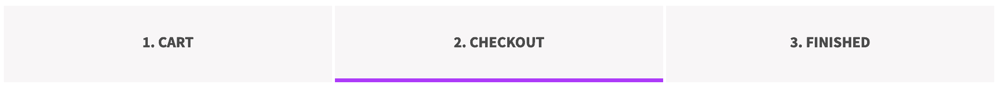
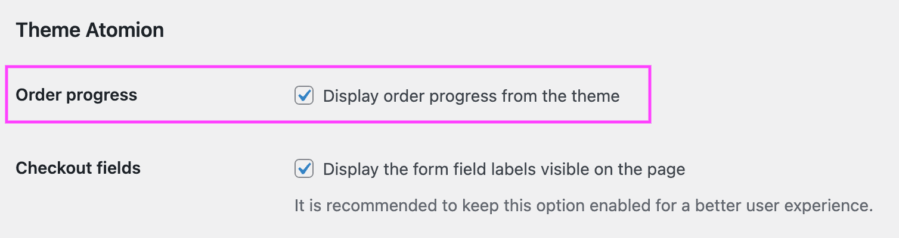

# Compatibility with theme Atomion

When using the Atomion theme, some theme features might be deactivated depending on which features are enabled on Fluid Checkout settings.

## Atomion order progress section {/* #checkout-progress-bar */}

Atomion has an order progress section which is displayed on a few pages when it is enabled in the theme settings: the cart page, checkout and order confirmation (thank you page).

By default, this section is removed by Fluid Checkout. However, it is possible restore this section to be displayed when using Fluid Checkout, which is most useful when if you are not using [Fluid Checkout PRO](https://fluidcheckout.com/) with the optimized cart and order received pages.

Follow the steps below to display the order progress section from Atomion:

1. Go to WP Admin > Appearance > Customize, then go to the sub section WooCommerce > Cart.
2. Locate the section “Cart page”.
3. Enable the option “Enable Order Progress Display”.
4. Save the theme settings by clicking the button “Publish” at the top of the Customizer options.
5. Go to WP Admin > Fluid Checkout > Settings > Integrations.
6. Locate the section “Theme Atomion > Order progress”.
7. Check the option “Display order progress from the theme”.
8. Then save your changes.

## Checkout form field labels {/* #2-toc-title */}

By default, the theme ZK Nito will remove the form field labels on the checkout and cart pages.

However, completely removing the labels elements from the page, as the theme does, will result in **accessibility issues** for people using screen readers as they will not know which field they are typing in.

Fluid Checkout will restore the form field label elements and make them visually hidden on page, while keeping them accessible for screen readers. Visually there will be no difference.

**It is possible to make the form field labels visible on the checkout page** by enabling an option in the plugin integration settings.

Follow the steps below to display the checkout form field labels with the theme ZK Nito:

1. Go to WP Admin > Fluid Checkout > Settings > Integrations.
2. Locate the section “Theme ZK Nito > Checkout fields”.
3. Check the option “Display the form field labels visible on the page”.
4. Then save your changes.
