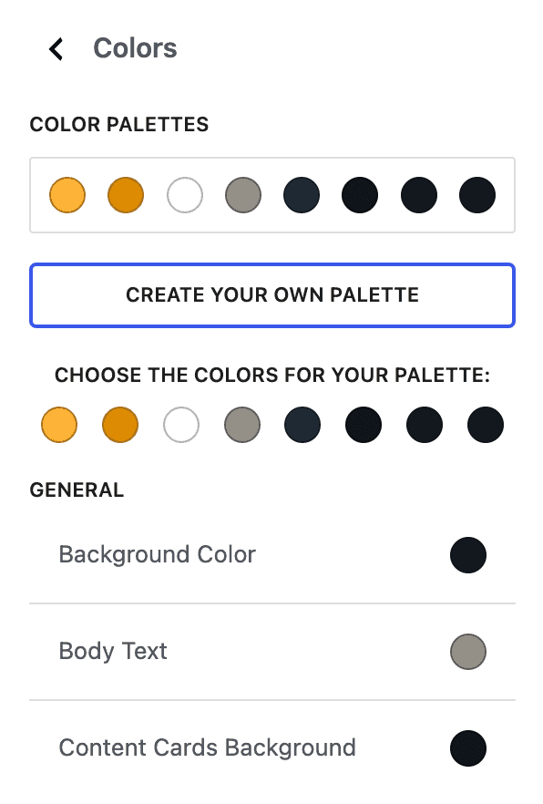
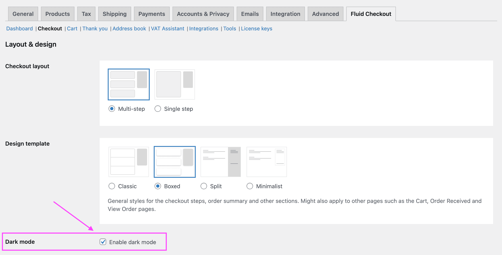
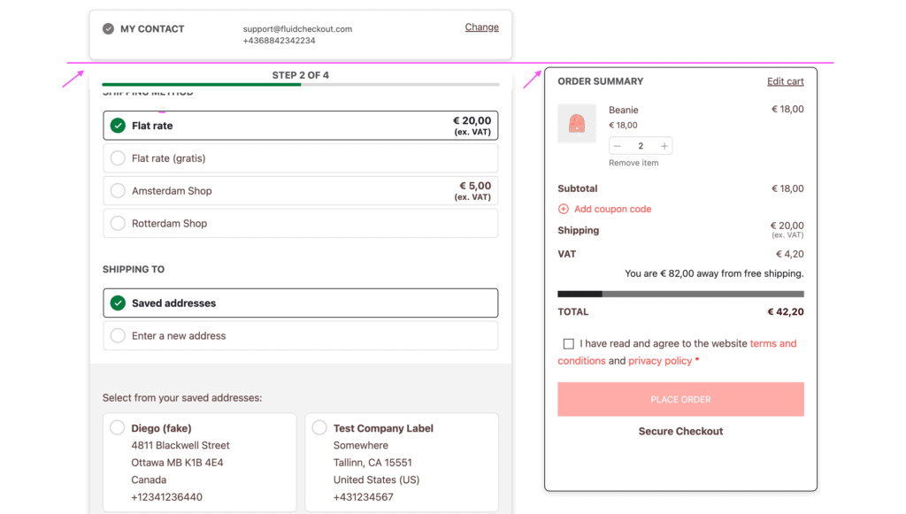
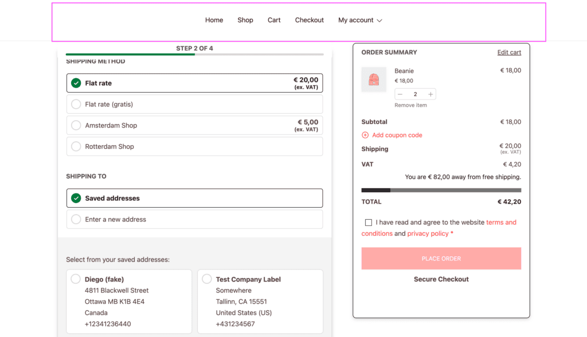
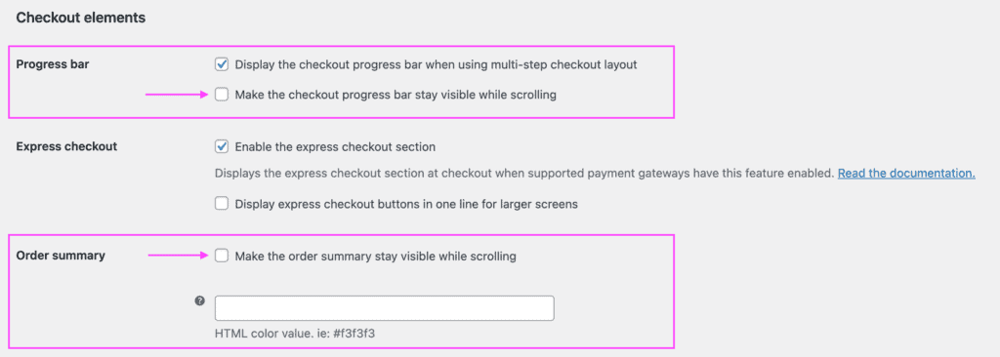
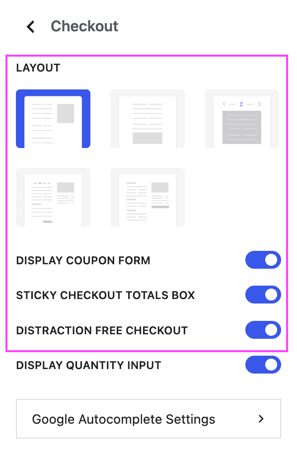
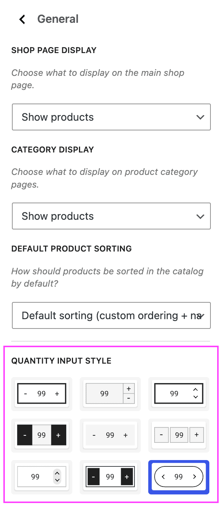
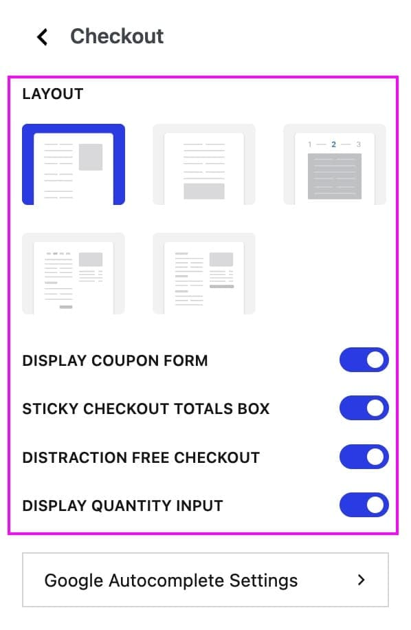
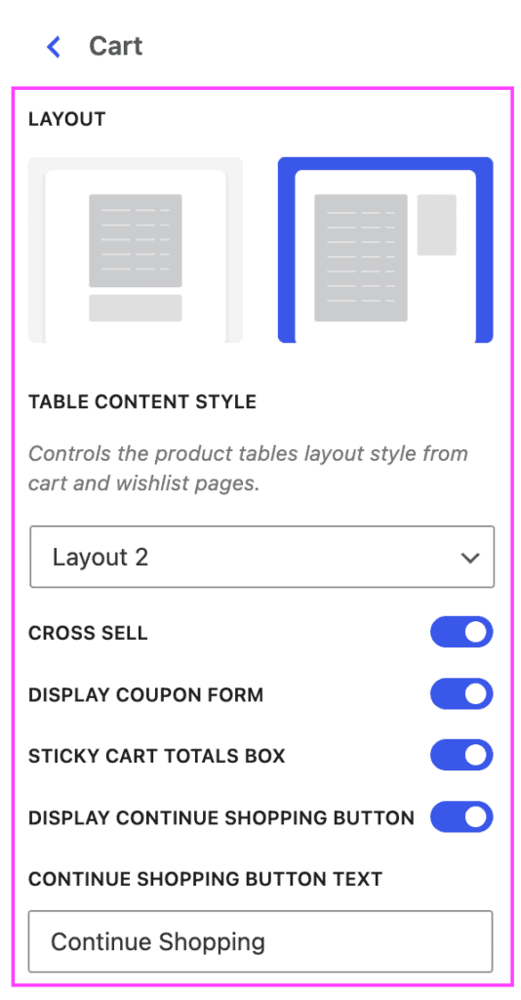
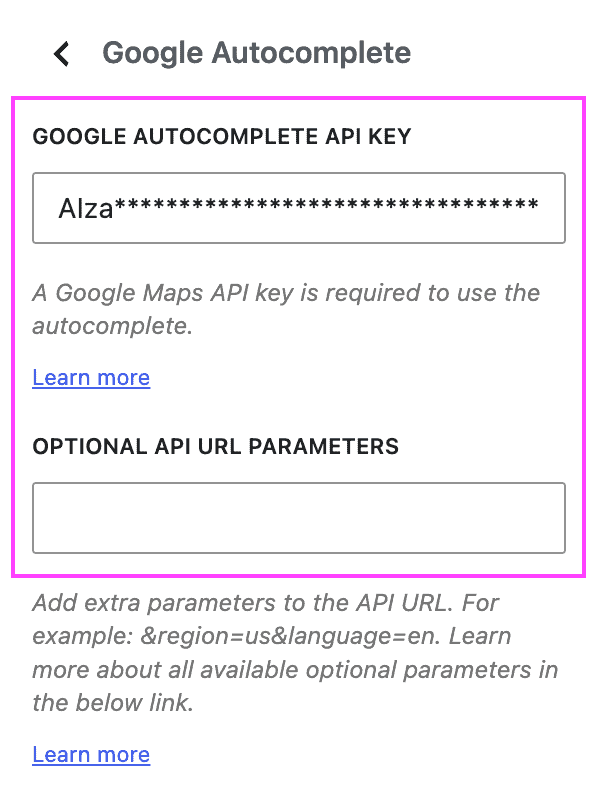

# Compatibility with theme Botiga

When using the Botiga theme, some theme features might be deactivated depending on which features are enabled on Fluid Checkout settings.

## Theme color customization options, and dark mode option

Botiga allows you to customize colors used on your website, and Fluid Checkout will use those colors on its optimized pages.

Fluid Checkout will inherit the theme color settings on all optimized pages, more specifically to define the button colors:

- Checkout
- Cart
- Order received (thank you page)
- View order
- Edit address

### Dark mode {/* #dark-mode */}

It is also possible to define colors in the Botiga theme options with dark backgrounds and light text. If that is the case on your website, you will need to manually enable the Dark Mode option in Fluid Checkout settings:

Follow the steps below to enable Dark Mode in plugin settings:

1. Go to WP Admin > Fluid Checkout > Settings > Checkout.
2. Locate the section “Layout & design > Dark mode”.

3. Check the option “Enable dark mode”.
4. Save your changes clicking the button “Save changes” at the bottom of the settings page.

## Quirky sticky header behavior {/* #sticky-header */}

When using the sticky header options from the Botiga theme, some of the sticky elements from Fluid Checkout on the checkout and cart page might appear to be positioned in the wrong place.

This happens because the site header is set to its sticky position, however it is not displayed while the user is scrolling down the page.

The site header will only appear when the user scrolls up, then the progress bar and order summary sections of Fluid Checkout will appear sticky right below the header.

Unfortunately, **there is no way to determine the right position** of the progress bar and order summary sections in this situation and show it at the top and move down once the header is shown.

To fix this behavior, we recommend:

- Setting the theme header as always sticky (not depending on scroll direction)
- Disabling the theme sticky header entirely in the theme options; or
- [Setting the progress bar and order summary to scroll normally](#disable-sticky-elements) with the page in the plugin settings (below).

### Disable options for sticky progress bar and order summary {/* #disable-sticky-elements */}

If you are using the sticky header settings of the Botiga theme, you might want to disable the options to set the progress bar and order summary sections as sticky elements, letting them scroll normally with the page.

Follow the steps below to set the progress bar and order summary to scroll normally with the page:

1. Go to WP Admin > Fluid Checkout > Settings > Checkout.
2. Locate the section “Checkout elements”.

3. Locate the sub-section “Progress bar” and uncheck the option “Make the checkout progress bar stay visible while scrolling”.
4. Locate the sub-section “Order summary” and uncheck the option “Make the order summary stay visible while scrolling”.
5. Save your changes clicking the button “Save changes” at the bottom of the settings page.

If you also have [Fluid Checkout PRO](https://fluidcheckout.com/) installed and activated, you might want to set the order summary on the cart page to scroll normally with the page:

1. Go to WP Admin > Fluid Checkout > Settings > Cart.
2. Locate the section “Cart elements”.
3. Locate the sub-section “Order summary” and uncheck the option “Make the order summary stay visible on the cart page while scrolling”.
4. Save your changes clicking the button “Save changes” at the bottom of the settings page.

## Botiga theme options and Fluid Checkout Lite features {/* #compat-lite-features */}

Some of the **Botiga theme** options, including those added with the companion plugin **Botiga PRO** conflict with features from Fluid Checkout, for that reason these features need to be disabled when using Fluid Checkout.

The following features from the Botiga theme will be automatically disabled when using Fluid Checkout Lite:

- WP Admin > Appearance > Customizer 
  - WooCommerce > Checkout 
    - Layout
    - Display coupon form
    - Sticky checkout totals box
    - Distraction free checkout

If you have any of these features enabled in the Botiga theme settings, they will have no effect on the checkout pages when using Fluid Checkout Lite. You can still use the Fluid Checkout options to manage some of these features.

## Botiga theme options and Fluid Checkout PRO features {/* #compat-pro-features */}

If you also have [Fluid Checkout PRO](https://fluidcheckout.com/) installed and activated, the following features from the Botiga theme and Botiga PRO plugin will be automatically disabled depending on the Fluid Checkout features enabled:

- WP Admin > Appearance > Customizer 
  - WooCommerce > General 
    - Quantity input style (disabled on the cart page, and on the checkout page when using the the feature [edit cart items at checkout](https://fluidcheckout.com/docs/feature-checkout-edit-cart/))
  - WooCommerce > Checkout 
    - Layout
    - Display coupon form
    - Sticky checkout totals box
    - Display quantity input (disabled on the checkout page when using the the feature [edit cart items at checkout](https://fluidcheckout.com/docs/feature-checkout-edit-cart/))
    - Distraction free checkout 
  - WooCommerce > Cart 
    - Layout
    - Table content style
    - Cross sell
    - Display coupon form
    - Sticky cart totals box
    - Display continue shopping button

If you have any of these features enabled in the Botiga theme and Botiga PRO plugin settings, they will have no effect on the optimized cart and checkout pages when using [Fluid Checkout PRO](https://fluidcheckout.com/). You can still use the Fluid Checkout options to manage some of these features.

## Compatibility with Google Address Autocomplete {/* #compat-fcgaa */}

Botiga PRO includes a feature to enable Google Address Autocomplete on the checkout page.

If you have our [Google Address Autocomplete add-on](https://fluidcheckout.com/fc-google-address-autocomplete/) installed and activated, the autocomplete feature from the theme will be automatically disabled, and the feature from our add-on will be used instead.

The following theme settings will be automatically disabled when using our [Google Address Autocomplete add-on](https://fluidcheckout.com/fc-google-address-autocomplete/):

- WP Admin > Appearance > Customize 
  - Google Autocomplete

Changes to these settings will not take effect on the checkout page when using the Google Address Autocomplete add-on. See our guide [Getting started with Google Address Autocomplete](https://fluidcheckout.com/docs/getting-started-google-address-autocomplete/) for more information on how to configure the add-on or change its settings.
