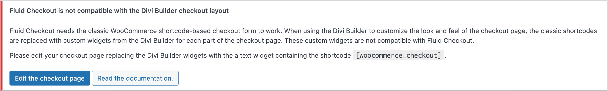
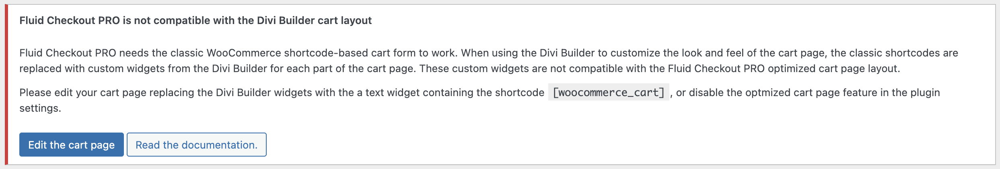
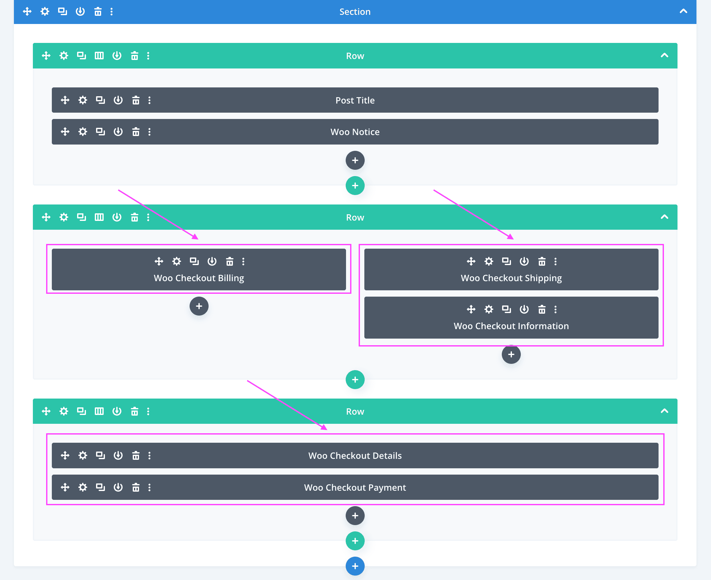
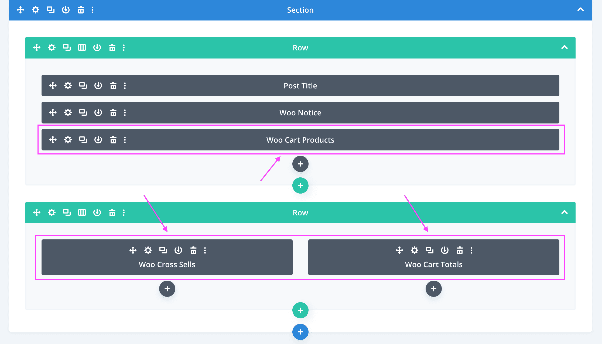
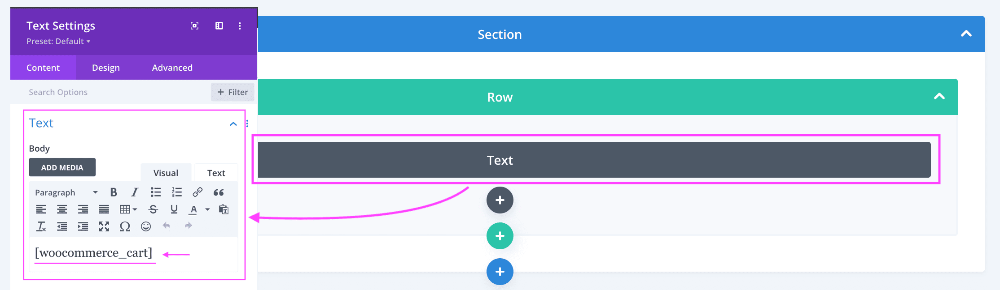

# Compatibility with theme Divi and the Divi Builder

## Shortcode-based checkout vs Divi Builder widgets {/* #shortcode-vs-blocks */}

Fluid Checkout [needs the classic WooCommerce shortcode-based checkout form to work](/compatibility/woocommerce-blocks/). When using the Divi Builder to customize the look and feel of the checkout page, the classic shortcodes are replaced with custom widgets from the Divi Builder for each part of the checkout page. These custom widgets from the Divi Builder are not compatible with Fluid Checkout.

In case your checkout page has any of the custom Divi Builder widgets added to its content, Fluid Checkout will display a message in your website admin area:



If you see this message in your website admin area, it means you may need to replace the Divi Builder custom checkout widgets with the classic checkout shortcode below:

```
[woocommerce_checkout]
```



Similarly, if you are using the optimized cart page feature from [Fluid Checkout PRO](https://fluidcheckout.com/), a similar message will appear in your website admin area and you may need to replace the Divi Builder custom cart widgets with the cart shortcode below:

```
[woocommerce_cart]
```

### Checkout page

Follow the steps below to check whether you have the Divi Builder custom widgets on your checkout page, and replace them with the classic shortcode-based form if needed:

1. Go to WP Admin > Pages.
2. Locate the page selected as your Checkout page, then click the option “Edit with Divi” if present, or “Edit” to start editing the page in the Divi Builder page editor.
3. In the Divi Builder page editor, enable the Wireframe View and then locate the **Checkout widgets**. If you do not find the Checkout widgets on the page content, skip to step 5.



4. Delete each custom Checkout widgets from the Divi Builder and respective layout rows.
5. Add a new layout row, and inside it a new Text widget. Then add the shortcode `[ woocommerce_checkout ]` as the Text widget content.


6. Save the changes.

### Cart page

If you have [Fluid Checkout PRO](https://fluidcheckout.com/), similarly to replacing the custom checkout widgets with the shortcode for the checkout form (see above), you may also need to replace the cart widgets with the shortcode for the cart page. Follow the steps below to check whether you have the Divi Builder custom widgets on your cart page, and replace them with the classic shortcode-based form if needed:

1. Go to WP Admin > Pages.
2. Locate the page selected as your Cart page, then click the option “Edit with Divi” if present, or “Edit” to start editing the page in the Divi Builder page editor.
3. In the Divi Builder page editor, enable the Wireframe View and then locate the **Cart widgets**. If you do not find the Checkout widgets on the page content, skip to step 5.



4. Delete each custom Cart widgets from the Divi Builder and respective layout rows.
5. Add a new layout row, and inside it a new Text widget. Then add the shortcode `[ woocommerce_cart ]` as the Text widget content.



6. Save the changes.
