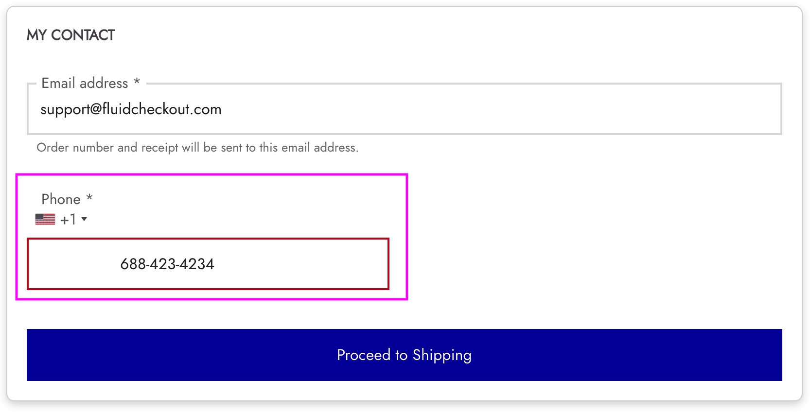
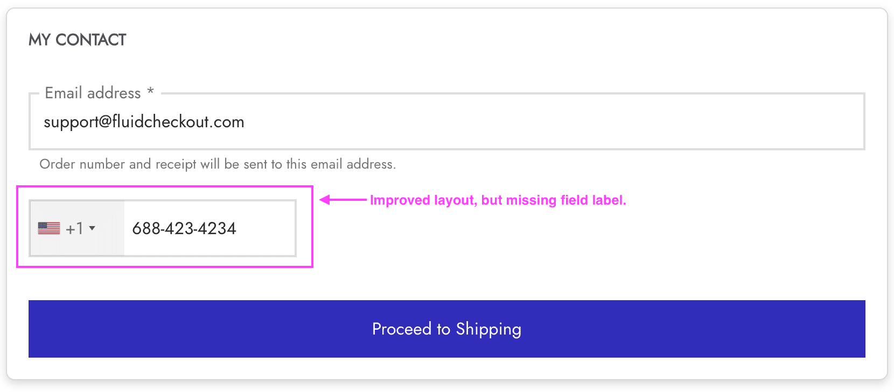

# Compatibility with theme Goya

## Compatibility with the International phone field PRO feature

[Fluid Checkout PRO](https://fluidcheckout.com/) will format and validate the phone number fields based on the rules for each country and region and add a drop-down field for the country code and flag to each phone number field on the checkout page with the [international phone numbers feature](https://fluidcheckout.com/docs/feature-international-phone-numbers/).

Unfortunately, **this feature is not 100% compatible with the floating labels** feature of the theme Goya because of the way that feature works on the theme. The layout of the field might appear broken for some time while loading the page:

It will usually improve a couple of seconds after the page is loaded but the field **will lose its label element**. In any case, there is no guarantee that it will actually improve after loading the page:

**There is currently no solution for this issue and it is not possible to disable the floating labels feature from the theme either.**
