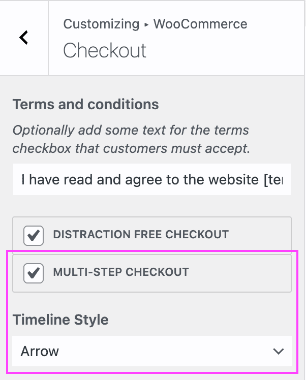

# Compatibility with theme OceanWP

When using the OceanWP theme, some theme features might be deactivated depending on which features are enabled on Fluid Checkout settings.

## OceanWP checkout options {/* #checkout-options */}

OceanWP has some features build-in to change the layout and behavior of checkout page which conflict with features from Fluid Checkout.

The “Multi-step Checkout” feature and related “Timeline styles” options from the OceanWP theme will be automatically disabled. Changes to these settings will have no effect on the checkout page when using Fluid Checkout.

