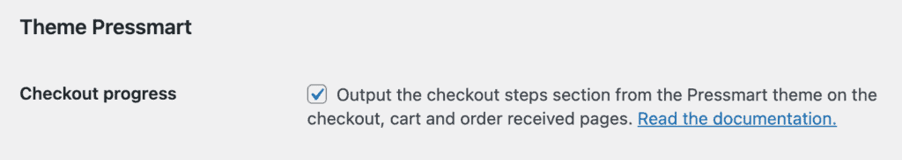

# Compatibility with theme Pressmart

When using the Pressmart theme, some theme features might be deactivated depending on which features are enabled on Fluid Checkout settings.

## Pressmart checkout progress section {/* #checkout-progress-bar */}

Pressmart has a checkout progress bar section which is displayed on a few pages: the cart page, checkout and order confirmation (thank you page).

By default, this option is removed by Fluid Checkout on the checkout page, and on the cart and order received pages if these features are enabled in [Fluid Checkout PRO](https://fluidcheckout.com/) plugin settings.

It is possible to display the checkout progress bar section from the Pressmart theme when using Fluid Checkout, which might be needed to keep consistency between all the checkout process pages, especially if you are not using [Fluid Checkout PRO](https://fluidcheckout.com/) with the optimized cart and order received pages.

Follow the steps below to display the checkout progress bar from Pressmart:

1. Go to WP Admin > Fluid Checkout > Settings > Integrations.
2. Locate the section “Theme Pressmart > Checkout progress”.
3. Check the option “Output the checkout steps section from the Pressmart theme on the checkout, cart and order received pages.”.
4. Then save your changes.

