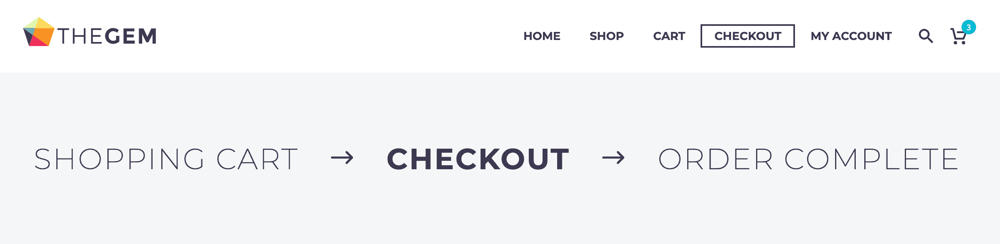
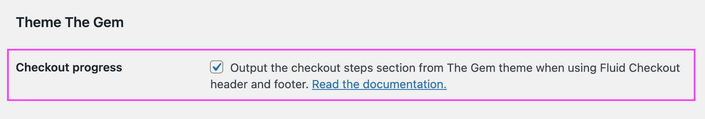

# Compatibility with theme The Gem

## The Gem checkout progress bar {/* #checkout-progress-bar */}

The Gem has a checkout progress bar section which is displayed on a few pages: the cart page, checkout and order confirmation (thank you page).

By default, this option is removed by Fluid Checkout when using the distraction free header and footer templates from the plugin.

It is possible to display the checkout progress bar section from the The Gem theme when using Fluid Checkout with the distraction free checkout template, which might be needed to keep consistency between all the checkout process pages, especially if you are not using [Fluid Checkout PRO](https://fluidcheckout.com/) with the optimized cart and order received pages.

Follow the steps below to display the checkout progress bar from The Gem:

1. Go to WP Admin > Fluid Checkout > Settings > Integrations.
2. Locate the section “Theme The Gem > Checkout progress”.
3. Check the option “Output the checkout steps section from The Gem theme when using Fluid Checkout header and footer”.
4. Then save your changes.

