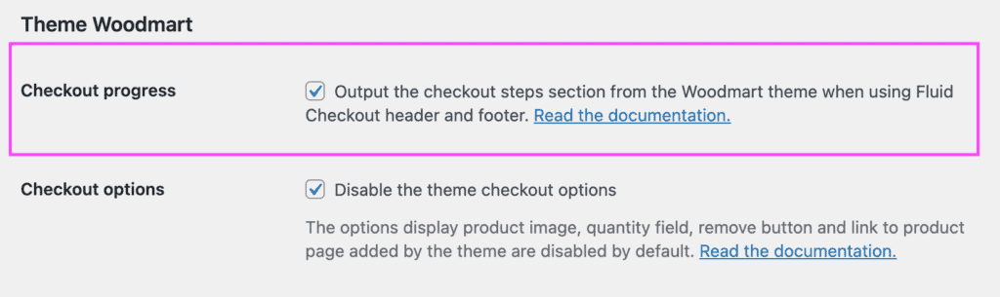
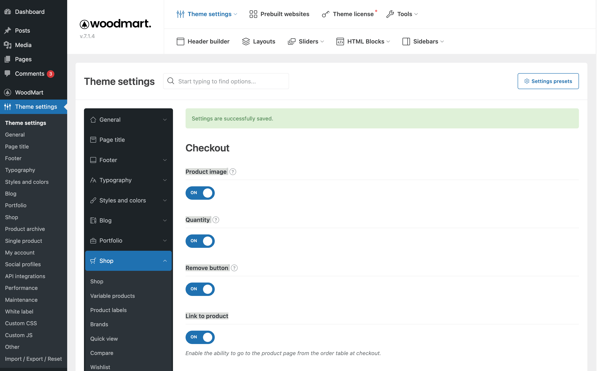
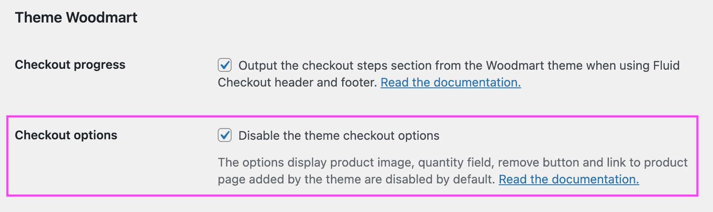

# Compatibility with theme Woodmart

When using the Woodmart theme, some theme features might be deactivated depending on which features are enabled on Fluid Checkout settings.

## Woodmart checkout progress bar {/* #checkout-progress-bar */}

Woodmart has a checkout progress bar section which is displayed on a few pages: the cart page, checkout and order confirmation (thank you page).

By default, this option is removed by Fluid Checkout when using the distraction free header and footer templates from the plugin.

It is possible to display the checkout progress bar section from the Woodmart theme when using Fluid Checkout with the distraction free checkout template, which might be needed to keep consistency between all the checkout process pages, especially if you are not using [Fluid Checkout PRO](https://fluidcheckout.com/) with the optimized cart and order received pages.

Follow the steps below to display the checkout progress bar from Woodmart:

1. Go to WP Admin > Fluid Checkout > Settings > Integrations.
2. Locate the section “Theme Woodmart > Checkout progress”.
3. Check the option “Output the checkout steps section from the Woodmart theme when using Fluid Checkout header and footer”.
4. Then save your changes.

## Woodmart checkout options {/* #checkout-options */}

Woodmart has introduced new options for the checkout page with version 7.1 of their theme. These options change the layout and behavior of cart items at the checkout page, conflicting with features from Fluid Checkout.

By default, the following features from the Woodmart theme will be automatically disabled when using Fluid Checkout:

- Woodmart Theme Options > Shop > Checkout 
  - Product image
  - Quantity
  - Remove button
  - Link to product

If you have any of these features enabled in the Woodmart theme settings, they will have no effect on the checkout page.

Follow the steps below to restore these theme options:

1. Go to WP Admin > Fluid Checkout > Settings > Integrations.
2. Locate the section “Theme Woodmart > Checkout options”.
3. Uncheck the option “Disable the theme checkout options”.
4. Then save your changes.

When using the feature [edit cart items at checkout](https://fluidcheckout.com/docs/feature-checkout-edit-cart/) from [Fluid Checkout PRO](https://fluidcheckout.com/), all these theme checkout options are **always disabled** as they conflict with the feature and would break the page functionality if enabled.

In the case of the option “Link to product” which would make the product name a link to the product description page, there is currently no replacement for this feature with Fluid Checkout.

## Filter and action hooks

### Best practices

If you are unsure about how to add the code snippets to your website, check our article:  
[How to safely add code snippets to your WooCommerce website](https://fluidcheckout.com/docs/how-to-add-code-snippets/)

### Filters

- [`fc_compat_theme_woodmart_disable_theme_checkout_options`](/lite/hooks/fc_compat_theme_woodmart_disable_theme_checkout_options/) – Controls whether to disable Woodmart theme checkout options
- [`fc_pro_cart_section_hook_priority_woodmart_free_gifts`](/pro/hooks/fc_pro_cart_section_hook_priority_woodmart_free_gifts/) – Filters the hook priority for Woodmart theme free gifts section.
