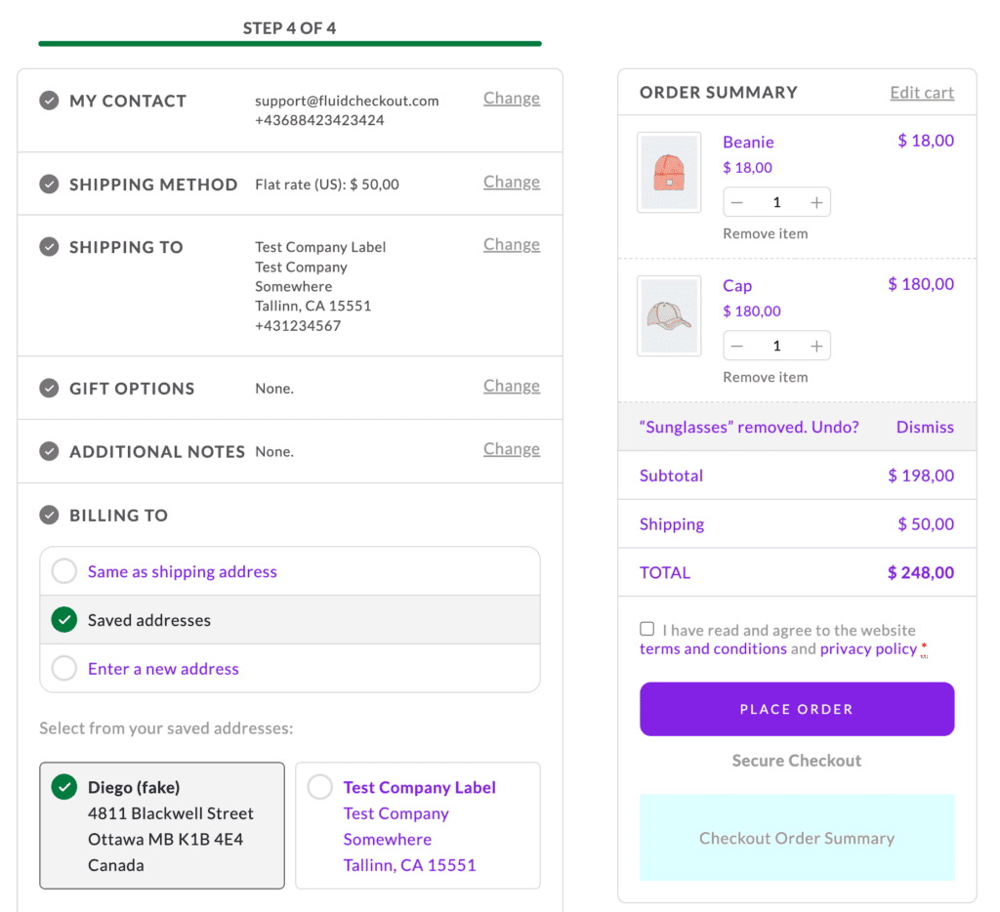

# Compatibility with theme ZK Nito

## Theme color customization options

If you customized the theme colors on your website, Fluid Checkout will use those colors on its optimized pages.

If you set the “primary” and “accent” colors in the ZK Nito theme options, these colors will be used for the buttons on the pages optimized by Fluid Checkout, and on some other elements which color is set by the theme.

*Purple color set to various elements on the checkout page when setting primary color for the theme ZK Nito.*

### Button colors and styles

Although, there are a few exceptions for customization options that do not apply on pages optimized with Fluid Checkout, more specifically the extra button settings:

- ZK Nito Theme Options > Extra options: 
  - Default Button *(used for secondary action buttons)* 
    - Border top (px)
    - Border right (px)
    - Border down (px)
    - Border left (px)
    - Border styles
    - Border color *(partially used)*
  - Primary Button *(used for primary action buttons)* 
    - Border top (px)
    - Border right (px)
    - Border down (px)
    - Border left (px)
    - Border styles
    - Border color *(partially used)*

## Checkout form field labels

By default, the theme ZK Nito will remove the form field labels on the checkout and cart pages.

However, completely removing the labels elements from the page, as the theme does, will result in **accessibility issues** for people using screen readers as they will not know which field they are typing in.

Fluid Checkout will restore the form field label elements and make them visually hidden on page, while keeping them accessible for screen readers. Visually there will be no difference.

**It is possible to make the form field labels visible on the checkout page** by enabling an option in the plugin integration settings.

Follow the steps below to display the checkout form field labels with the theme ZK Nito:

1. Go to WP Admin > Fluid Checkout > Settings > Integrations.
2. Locate the section “Theme ZK Nito > Checkout fields”.
3. Check the option “Display the form field labels visible on the page”.
4. Then save your changes.

## Extra shipping email and shipping phone fields added by the theme {/* #extra-shipping-fields */}

By default, the theme ZK Nito will add two extra shipping fields: shipping email and shipping phone.

With Fluid Checkout, these extra fields are not added by default when using the theme ZK Nito because the shipping email field is not commonly used and the shipping phone field is already added by Fluid Checkout.

**It is possible to add these extra fields from the theme ZK Nito** by enabling an option in the plugin integration settings.

Follow the steps below to enable adding the extra shipping fields from the theme ZK Nito:

1. Go to WP Admin > Fluid Checkout > Settings > Integrations.
2. Locate the section “Theme ZK Nito > Checkout fields”.
3. Check the option “Add extra fields to the checkout form”.
4. Then save your changes.

Moreover, some customizations to the default extra shipping fields from the theme ZK Nito using 3rd-party checkout field editor plugins would not work because of the way the extra fields are added to the checkout form. With Fluid Checkout, there customizations will work as expected.
