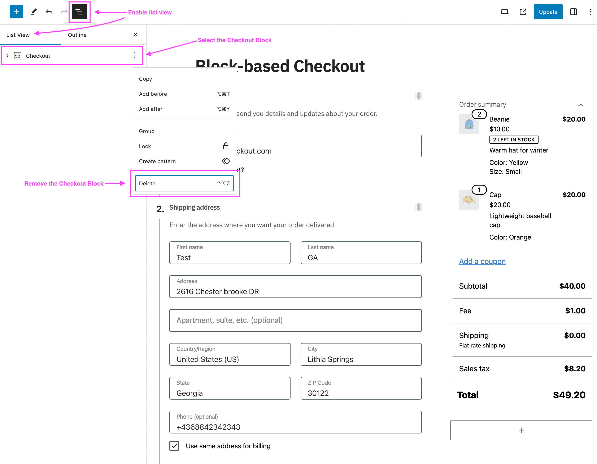
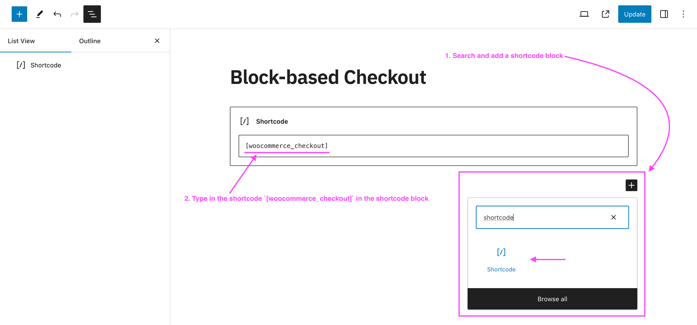

# Compatibility with the WooCommerce Checkout and Cart blocks

Yes. Fluid Checkout works on sites that use the WooCommerce Checkout block. Fluid Checkout Lite 3.1.3 and newer automatically replaces the Checkout block with its own optimized checkout form. Fluid Checkout PRO 2.1.2 and newer does the same for the Cart block when the optimized cart page is turned on.

## How Fluid Checkout works with the Checkout and Cart blocks

WooCommerce can show the checkout and cart in two ways:

- **Shortcode-based (classic):** the page holds the `[woocommerce_checkout]` or `[woocommerce_cart]` shortcode. Up to WooCommerce 8.2, this was the default.
- **Block-based:** the page holds the WooCommerce Checkout block or Cart block. New sites created with WooCommerce 8.3 or newer get these blocks by default.

Fluid Checkout is built on the classic shortcode-based checkout form, so you do not have to rebuild your pages:

- **Checkout page:** With Fluid Checkout Lite 3.1.3 or newer, a checkout page that holds the Checkout block automatically shows the Fluid Checkout form instead.
- **Cart page:** With Fluid Checkout PRO 2.1.2 or newer and the optimized cart page turned on, a cart page that holds the Cart block automatically shows the Fluid Checkout optimized cart instead.
- **Block themes:** Fluid Checkout supports block themes that use the Site Editor (Full Site Editing), from Fluid Checkout Lite 3.1.0 and PRO 2.1.0.

The option to show or hide the Billing Company field is not available on the block-based checkout form. Fluid Checkout has its own visibility option for this field in WP Admin > Fluid Checkout > Settings.

## Set up Fluid Checkout on a site that uses the Checkout block

1. Go to WP Admin > Plugins > Add New Plugin, search for "Fluid Checkout", then install and activate Fluid Checkout Lite.
2. Go to WP Admin > Fluid Checkout > Settings, open the Checkout section, choose your options, and click **Save changes**.
3. Add a product to the cart and open your checkout page. It should now show Fluid Checkout.
4. Using Fluid Checkout PRO? Most PRO features are off by default. Open the Cart section to turn on the optimized cart page, and the Thank you section for the optimized order received page, then click **Save changes**.
5. Still seeing the block checkout or cart? Replace the block with the shortcode, as shown below.

## When to replace the blocks with the shortcodes

On current versions you usually do not need to change your pages. Replace the blocks with the shortcodes by hand if:

- You use Fluid Checkout Lite older than 3.1.3, or Fluid Checkout PRO older than 2.1.2.
- A third-party plugin does not work as expected on your checkout or cart page.
- You built your checkout or cart page with a page builder. See the guides for [Elementor](/compatibility/plugins/elementor/), [Divi](/compatibility/themes/divi/), and [CartFlows](/compatibility/plugins/cartflows/).

### Replace the Checkout block with the checkout shortcode

1. Open your checkout page in the editor:
   - Classic theme: go to WP Admin > Pages, then edit the page set as your Checkout page.
   - Block theme: go to WP Admin > Appearance > Editor > Pages, select Checkout, then click the Edit icon.
2. Open the **List View** and select the **Checkout** block. If the page has no Checkout block, skip to step 4.
3. Do one of the following:
   - Click **Transform** (the first button in the block toolbar) and choose **Classic Shortcode**.
   - Or delete the Checkout block and add a **Shortcode** block in its place.

4. Make sure the page holds this shortcode, and add it in a Shortcode block if it does not:

   `[woocommerce_checkout]`

5. Click **Save** or **Update**.
6. Check that this page is set as your Checkout page in WP Admin > WooCommerce > Settings > Advanced > Page setup.

### Replace the Cart block with the cart shortcode

You only need this if you use the optimized cart page from Fluid Checkout PRO.

1. Open your cart page in the editor:
   - Classic theme: go to WP Admin > Pages, then edit the page set as your Cart page.
   - Block theme: go to WP Admin > Appearance > Editor > Pages, select Cart, then click the Edit icon.
2. Open the **List View** and select the **Cart** block. If the page has no Cart block, skip to step 4.
3. Click **Transform** and choose **Classic Shortcode**, or delete the Cart block and add a **Shortcode** block in its place.
4. Make sure the page holds this shortcode:

   `[woocommerce_cart]`

5. Click **Save** or **Update**.
6. Check that this page is set as your Cart page in WP Admin > WooCommerce > Settings > Advanced > Page setup.

WooCommerce advises that the Cart and Checkout blocks work together, so if you move one page to the classic shortcode, move both.

### Order confirmation page on block themes

When you use the optimized order received (thank you) page from Fluid Checkout PRO with a block theme, Fluid Checkout uses the checkout page template for the order confirmation page.

Fluid Checkout PRO 3.0.5 and newer also has an option to use the WooCommerce **Order confirmation** template on block themes. It is off by default. The option's label in WP Admin > Fluid Checkout > Settings is not named on this page.

To use the Order confirmation template, replace its blocks with the checkout shortcode:

1. Go to WP Admin > Appearance > Editor, then open **Templates**.
2. Find the **Order confirmation** template and open it.
3. Click **Document overview** at the top of the editor and open the **List View**.
4. Remove the blocks for the order confirmation page: Order status, Order summary, Account creation, Order totals section, Downloads section, Shipping address section, Billing address section, Additional fields, and Additional information.
5. Add a **Shortcode** block in their place with this shortcode:

   `[woocommerce_checkout]`

6. Click **Save**.

## Known limitations and workarounds

- **Express checkout buttons:** Fluid Checkout is based on the classic shortcode-based checkout form, so payment gateways that only support the WooCommerce block-based checkout will not show their express payment buttons with the Fluid Checkout express checkout feature. See [Express checkout](https://fluidcheckout.com/docs/feature-express-checkout/) for the gateways this affects.
- **Third-party plugins:** If a plugin does not work as expected while your page still holds the Checkout or Cart block, replace the block with the shortcode as shown above. If that does not help, [ask us on the support forum](https://wordpress.org/support/plugin/fluid-checkout/).
- **Keep Fluid Checkout up to date:** Several issues on sites that use the block-based checkout were fixed in newer versions. Examples: the redirect to the cart page when the cart is empty (Lite 3.1.9 and 3.2.0), the order received page showing blank in some cases (Lite 3.1.9), and Advanced Coupons for WooCommerce Free when the checkout form was added as a block (Lite 4.1.0).

## FAQ

### Does Fluid Checkout work with the WooCommerce Checkout block?

Yes. Fluid Checkout Lite 3.1.3 and newer automatically replaces the WooCommerce Checkout block with the Fluid Checkout form. Fluid Checkout PRO 2.1.2 and newer does the same for the Cart block when the optimized cart page is on.

### Why does my block-based checkout stay the same after I activate Fluid Checkout?

First, update Fluid Checkout Lite to 3.1.3 or newer. If the checkout still does not change, replace the Checkout block with the `[woocommerce_checkout]` shortcode, as shown above. For the cart page, make sure you have Fluid Checkout PRO and that the optimized cart page is turned on in WP Admin > Fluid Checkout > Settings, in the Cart section. It is off by default.

### How do I switch from the block checkout to Fluid Checkout?

Install and activate Fluid Checkout Lite. On current versions, the Checkout block is replaced automatically, so there is nothing else to change. If you prefer to use the shortcode, or a plugin needs it, follow the steps in [Replace the Checkout block with the checkout shortcode](#replace-the-checkout-block-with-the-checkout-shortcode).

### Do I need Fluid Checkout PRO for the Checkout block?

Fluid Checkout Lite handles the Checkout block. Fluid Checkout PRO adds the optimized cart page and the optimized order received page, including the Cart block replacement.

### Does Fluid Checkout work with block themes?

Yes. Fluid Checkout supports block themes that use the Site Editor (Full Site Editing), from Fluid Checkout Lite 3.1.0 and PRO 2.1.0.

## Related docs

- [Getting started with Fluid Checkout](https://fluidcheckout.com/docs/getting-started-fluid-checkout/)
- [Express checkout](https://fluidcheckout.com/docs/feature-express-checkout/)
- [Compatibility with Elementor](/compatibility/plugins/elementor/)
- [Compatibility with Divi and the Divi Builder](/compatibility/themes/divi/)
- [Compatibility with CartFlows](/compatibility/plugins/cartflows/)
- [Plugins compatible with Fluid Checkout](/compatibility/plugins/)
- [Themes compatible with Fluid Checkout](/compatibility/themes/)
- [Customizing the Cart and Checkout pages (WooCommerce)](https://woocommerce.com/document/woocommerce-store-editing/customizing-cart-and-checkout/)

Still stuck? [Ask us on the support forum](https://wordpress.org/support/plugin/fluid-checkout/) and we will help.
