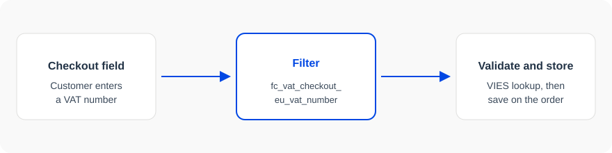

## What hooks are

EU-VAT Assistant runs WordPress actions and filters around the checkout VAT number. Use them to normalize the number, turn a compatibility module on or off, or print something next to the field. You do not need to edit the plugin.



## Best practices

If you are unsure about how to add the code snippet to your website, check our article:

[How to safely add code snippets to your WooCommerce website]({{CODE_SNIPPETS_ARTICLE_URL}})

## Actions and filters

A filter receives the current value and must return a replacement. [`fc_vat_number_field_args`](/eu-vat/hooks/fc_vat_number_field_args/) receives the VAT number field arguments.

Some hook names change at runtime. See [Dynamic hook names](#dynamic-hook-names).

The [filters](#filters) list below includes every hook exported from EU-VAT Assistant.

## Read a hook page

Open a hook for its type, the signature, the parameters table, the version that introduced it, and the PHP file that runs it. When you accept more than one parameter, set that count on `add_action` or `add_filter`. The [example](#example) below customizes the VAT number field.

## Example

```php
/**
 * Customize the VAT number field label and description.
 *
 * @param array $args VAT number field arguments.
 * @return array
 */
add_filter( 'fc_vat_number_field_args', function( $args ) {
    $args['label'] = __( 'Tax ID Number', 'my-store' );
    $args['description'] = __( 'Enter your business tax identification number.', 'my-store' );
    return $args;
}, 10 );
```

## Dynamic hook names

Some hook names change at runtime. On these pages a variable is written in braces, and the plugin prefix `fc_vat` stands in for `self::$plugin_prefix`.

| In the plugin | Name on this page |
| --- | --- |
| `'fc_vat_enable_compat_plugin_' . $plugin_slug` | `fc_vat_enable_compat_plugin_{plugin_slug}` |
| `'fc_vat_' . $current_section . '_settings'` | `fc_vat_{current_section}_settings` |
| `self::$plugin_prefix . '_admin_notices'` | `fc_vat_admin_notices` |

Register the concrete hook when you know the value:

```php
$plugin_slug = 'woocommerce-subscriptions';
add_filter( "fc_vat_enable_compat_plugin_{$plugin_slug}", '__return_false' );
```
