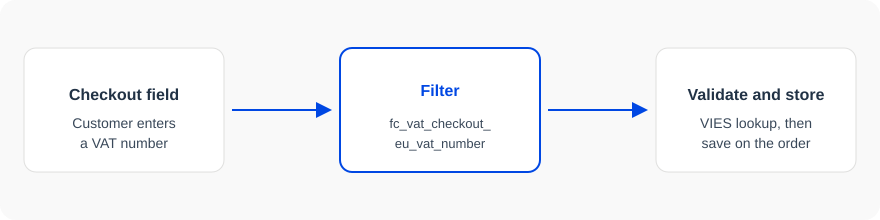

## What hooks are

Fluid Checkout PRO runs WordPress actions and filters for the cart, order pay, order received, and the features that ship with PRO. They work alongside Fluid Checkout Lite hooks, so a site running both plugins can use either set.

Address Book hooks use the prefix `fc_adb_`. Google Address Autocomplete hooks use the prefix `fc_gaa_`. EU VAT hooks use the prefix `fc_vat_`. You do not need to edit the plugin.

## Best practices

If you are unsure about how to add the code snippet to your website, check our article:

[How to safely add code snippets to your WooCommerce website]({{CODE_SNIPPETS_ARTICLE_URL}})

## Actions and filters

An action runs your code at a moment in the page. [`fc_pro_order_received_successful`](/pro/hooks/fc_pro_order_received_successful/) runs on the order received page after a successful order.

A filter receives the current value and must return a replacement. [`fc_pro_cart_action_label_continue_shopping`](/pro/hooks/fc_pro_cart_action_label_continue_shopping/) receives the Continue shopping label on the cart.

The [actions](#actions) and [filters](#filters) lists below include every hook exported from Fluid Checkout PRO, including the EU VAT hooks (`fc_vat_`).

## Read a hook page

Open a hook for its type, the signature, the parameters table, the version that introduced it, and the PHP file that runs it. When you accept more than one parameter, set that count on `add_action` or `add_filter`. The [example](#example) below accepts the order object passed to the order received action.

## Example

```php
/**
 * Change the Continue shopping label on the cart.
 *
 * @param string $value Label text.
 * @return string
 */
add_filter( 'fc_pro_cart_action_label_continue_shopping', function( $value ) {
    return __( 'Back to the shop', 'my-store' );
}, 10 );

/**
 * Thank the customer on the order received page.
 *
 * @param \WC_Order $order Order object.
 */
add_action( 'fc_pro_order_received_successful', function( $order ) {
    echo '<p>' . esc_html( sprintf(
        /* translators: %s: customer first name */
        __( 'Thanks for your order, %s.', 'my-store' ),
        $order->get_billing_first_name()
    ) ) . '</p>';
}, 10 );
```

## EU VAT hooks

EU VAT features in Fluid Checkout PRO run actions and filters around the checkout VAT number. Use them to normalize the number, turn a compatibility module on or off, or print something next to the field.



[`fc_vat_number_field_args`](/pro/hooks/fc_vat_number_field_args/) receives the VAT number field arguments.

```php
/**
 * Customize the VAT number field label and description.
 *
 * @param array $args VAT number field arguments.
 * @return array
 */
add_filter( 'fc_vat_number_field_args', function( $args ) {
    $args['label'] = __( 'Tax ID Number', 'my-store' );
    $args['description'] = __( 'Enter your business tax identification number.', 'my-store' );
    return $args;
}, 10 );
```

## Dynamic hook names

Some `fc_vat_` hook names change at runtime. On these pages a variable is written in braces, and the prefix `fc_vat` stands in for `self::$plugin_prefix`.

| In the plugin | Name on this page |
| --- | --- |
| `'fc_vat_enable_compat_plugin_' . $plugin_slug` | `fc_vat_enable_compat_plugin_{plugin_slug}` |
| `'fc_vat_' . $current_section . '_settings'` | `fc_vat_{current_section}_settings` |
| `self::$plugin_prefix . '_admin_notices'` | `fc_vat_admin_notices` |

Register the concrete hook when you know the value:

```php
$plugin_slug = 'woocommerce-subscriptions';
add_filter( "fc_vat_enable_compat_plugin_{$plugin_slug}", '__return_false' );
```
